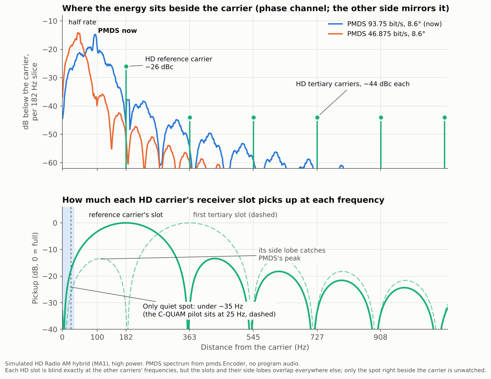

# PMDS Draft Specification, version 0.2

Michael Foley, KK4EKN · last revised Nov 17, 2026

## 1. Scope and status

This draft defines PMDS (Phase Modulation Data Service, working name): station identity, text, program type and an alert flag carried as slow phase modulation of a mono AM broadcast carrier, at 93.75 bit/s with 8.6 degrees (0.15 rad) peak deviation. It is a discussion draft; nothing in it is final or endorsed by any body.

- **Stations:** mono AM (amplitude modulation, A3E) stations in the US AM band. Stations broadcasting C-QUAM AM stereo are excluded, since stereo uses the same carrier phase. HD Radio hybrid stations are excluded too: PMDS's energy falls in the receiver slot of their reference carriers (section 10).
- **Normative and informative:** sections 2 to 8 are normative; SHALL and SHOULD carry their usual meaning there. Sections 9 onward and the appendices are informative.
- **Reference implementation:** the `pmds` package (encoder, decoder and framing in Python and numpy, no GNU Radio needed) under the Apache License 2.0, and a port of the decoder to plain C for microcontrollers (`c/`, also Apache 2.0, giving the same bits as the Python decoder), with GNU Radio blocks and bench tools around it (`pmds_encoder.py`, `pmds_addon.py`, `pmds_channel_test.py`, `pmds_check.py`) under GPL 3.0 or later. Where this text and the code disagree, this text is the intent and the code is a bug.

## 2. References

PMDS takes its field meanings from RBDS and defines only how they are carried; these documents are referenced, not reproduced.

| Reference | Used for |
| --- | --- |
| IEC 62106 series (RDS), basic character set G0 | The 8-bit character table (section 6) |
| IEC 62106-9, RBDS (successor to NRSC-4-B) | Program type codes, PI derivation from US call letters, RT+ content types, AF code meaning for FM |
| [47 CFR 73.127](https://www.law.cornell.edu/cfr/text/47/73.127) | AM multiplex transmissions; the audibility and no-degradation conditions |
| [47 CFR 11.45](https://www.law.cornell.edu/cfr/text/47/11.45) | No EAS codes or attention signal outside real alerts and tests |
| [ETSI TS 102 386](https://www.etsi.org/deliver/etsi_ts/102300_102399/102386/01.01.01_60/ts_102386v010101p.pdf) (AMSS) | Prior art for the physical layer and block size; not a dependency |
| [ITU-R BS.706-1](https://itu.int/dms_pubrec/itu-r/rec/bs/R-REC-BS.706-1-199203-S!!MSW-E.doc) (AMDS, 1992) | Prior art: data by phase modulation of the main carrier on LF and MF, up to 200 bit/s, with example systems at 25 bit/s biphase ±22.5°, 40 bit/s ±28.5° and 200 bit/s ±15°; revised as BS.706-2 in 1998; not a dependency |
| [BBC RD 1984/19](https://downloads.bbc.co.uk/rd/pubs/reports/1984-19.pdf), L.F. radio-data | Prior art in long service: biphase phase modulation of BBC Radio 4's 198 kHz carrier at 25 bit/s, ±22.5°, from 1985 until the 198 kHz transmitters closed on 27 June 2026 ([RSGB](https://rsgb.org/main/blog/news/rsgb-notices/2026/05/29/the-closure-of-bbc-long-wave/), [history](https://en.wikipedia.org/wiki/Radio_teleswitch)) |
| [US 3,714,375](https://patents.google.com/patent/US3714375A/en) (Collins Radio, 1970) | Prior art for the core principle: a secondary phase-modulated communications service carried by AM broadcast stations; expired |
| [US 4,688,255](https://patents.google.com/patent/US4688255A/en) (L. R. Kahn, 1984) | Prior art for the core principle: a compatible AM broadcast and data transmission system; expired |
| [US 4,117,405](https://patents.google.com/patent/US4117405A/en) and related patents (Martinez, 1976 to 1982) | Prior art: narrow-band phase modulation of an AM broadcast carrier for data, paging, utility load control and public alerts, with the bit clock divided down from the carrier; expired |
| [EP 0347541](https://patents.google.com/patent/EP0347541A1/en) and [EP 0367897](https://patents.google.com/patent/EP0367897A2/en) (Licentia, 1988) | Prior art, the closest single precedent: "AM-RDS", biphase-coded, digitally shaped data phase-modulated onto long-, medium- and shortwave broadcast carriers within ±30°, at about 97.6 to 195 bit/s, carrying programme identity and name, programme type, AF lists, traffic, alarms and time. The second application traces audibility to PM-to-AM conversion on receiver IF filter skirts. Never granted |
| [US 5,444,720](https://patents.google.com/patent/US5444720A/en) (Telefunken, 1990) | Prior art: RDS-style fields (PI, PS, AF, TP, TA, RadioText) in repeating groups on an AM carrier's phase; expired |
| CCIR Report 1061, *Recommendations and Reports of the CCIR*, Dubrovnik 1986, Vol. X Part 1 | Prior art in an ITU publication: the BBC system (25 bit/s biphase, ±22.5°, 50-bit blocks with a 13-bit CRC, on air from October 1981 with no listener complaints) and an East German system at up to 100 bit/s on a high-power broadcast transmitter |
| [EP 1079557](https://patents.google.com/patent/EP1079557A2/en) (Deutsche Telekom, 1999) | States as known art that the RDS protocol was carried on long wave as phase modulation of a carrier; never granted |

PMDS is a new format, not a profile of AMDS or AMSS; those systems are cited only for comparison. The BBC service is the strongest precedent: a phase-modulated data signal on a national broadcast carrier for four decades, with its parameters [chosen](https://www.sigidwiki.com/images/2/29/1984-19.pdf) so that domestic receivers were not disturbed. The closest design precedent is Licentia's 1988 AM-RDS: the same kinds of fields, biphase data and a bit rate near PMDS's, on the carrier phase of AM broadcast transmitters. What PMDS adds is a complete, open specification for US medium-wave stations, with RBDS field meanings, a measured deviation limit and a tested reference receiver.

## 3. Physical layer

Data SHALL be carried only on the carrier's phase, as one sine cycle of phase per bit, leaving the envelope exactly as the station's AM modulator made it. In complex baseband, with A(t) the station's envelope (1 + m(t)):

```math
s(t) = A(t)\, e^{\,j\theta(t)}, \qquad \theta(t) = \Delta\,(2b_k - 1)\,\sin\!\left(\frac{2\pi\,(t - kT)}{T}\right), \quad kT \le t < (k+1)T
```

A 1 bit swings the phase forward (a phase advance) for the first half of the bit and back for the second; a 0 bit does the reverse. The phase is zero at every bit boundary, so the waveform is continuous and has no energy at DC.

| Parameter | Value |
| --- | --- |
| Bit rate 1/T | 93.75 bit/s (T = 10.667 ms) |
| Bit rate accuracy | SHALL be within 50 ppm; it SHOULD be derived from the transmitter's frequency reference |
| Peak deviation Δ | 8.6 degrees (0.15 rad) nominal and maximum, held constant. Lower values down to 5 degrees are permitted, at a cost at night (section 11). The maximum keeps the synchronous-detector tone 45 dB below 100% modulation (section 10) |
| Envelope | Unchanged by the data, to the precision of the encoder's arithmetic |
| Transmission | Continuous, group after group, while the service is on |
| Occupied spectrum | About 99% of the data's power within ±200 Hz of the carrier |
| Carrier frequency | Unaffected: the mean phase is zero |

The phase modulation SHALL be applied ahead of the transmitter's final stage (in the exciter, or between the frequency source and the RF input) so that the audio chain is untouched. The transmitter's own incidental phase modulation SHOULD be below 3 degrees peak at 95% modulation.

An encoder that builds each bit from a whole number of samples SHALL run at a sample rate that is a whole multiple of the bit rate: 192, 96 or 48 kHz, for example. Any other rate rounds the bit's length and puts the bit rate off, by 851 ppm at 44.1 kHz. The reference encoder refuses such a rate; its GNU Radio block prints a warning instead.

## 4. Blocks and check code

Every block is 47 bits: 36 data bits followed by an 11-bit check word, sent most significant bit first. Two blocks make a group; the check word's offset says which kind of block it is, which also gives the receiver block sync.

```math
c(x) = \left[\, d(x)\, x^{11} \bmod g(x) \,\right] \oplus o(x), \qquad g(x) = x^{11} + x^{7} + x^{6} + x^{3} + x^{2} + x + 1 \;\;(\text{0x8CF})
```

Here d(x) is the 36 data bits and o(x) the offset word. A received block is valid when the remainder of all 47 bits divided by g(x) equals one of the offset words. At this length g(x) has minimum distance 4: it detects every error of 1 to 3 bits and every burst up to 11 bits, and allows single-bit correction with double errors still detected. It was chosen by exhaustive search as the 11-bit polynomial with the fewest undetectable 4-bit errors at 47 bits.

| Block | Offset word | Group type |
| --- | --- | --- |
| core1 | 0x185 | Core, block 1 |
| core2 | 0x3CB | Core, block 2 |
| rt1 | 0x066 | RadioText, block 1 |
| rt2 | 0x1BF | RadioText, block 2 |
| ext1 | 0x03D | Extended, block 1 |
| ext2 | 0x007 | Extended, block 2 |

The offsets were chosen so that no 1-bit or 2-bit error can turn one block type into another, and so that neither an all-zeros nor an all-ones block looks valid. A group's block 2 SHALL carry the offset matching its block 1.

## 5. Groups

There are three group types: core (station identity and half the name), RadioText (8 characters of text), and extended (the station's PI again and one of several slower fields, chosen by a 4-bit type). Bit numbers count down from 35, the first bit sent in each block's data. Reserved bits SHALL be sent as 0 and ignored on receipt.

**Core group**

| Block | Bits | Field |
| --- | --- | --- |
| 1 | 35 to 20 | PI, 16 bits |
| 1 | 19 to 15 | PTY, 5 bits |
| 1 | 14 | TP |
| 1 | 13 | TA |
| 1 | 12 | AF list exists |
| 1 | 11 | PS segment: 0 = characters 1 to 4, 1 = characters 5 to 8 |
| 1 | 10 | Alert flag |
| 1 | 9 to 0 | Reserved |
| 2 | 35 to 4 | 4 PS characters, 8 bits each |
| 2 | 3 to 0 | Reserved |

**RadioText group**

| Block | Bits | Field |
| --- | --- | --- |
| 1 | 35 to 33 | Segment address, 0 to 7 (8 characters each, 64 in all) |
| 1 | 32 | Text A/B flag: changes whenever the text changes |
| 1 | 31 to 0 | Characters 1 to 4 of the segment |
| 2 | 35 to 4 | Characters 5 to 8 of the segment |
| 2 | 3 to 2 | Reserved |
| 2 | 1 to 0 | Alert level: 0 none, 1 test, 2 emergency, 3 reserved (section 8) |

**Extended group**

Block 1 bits 35 to 20 carry the PI, in the same place as in a core group, and bits 19 to 16 the type. The remaining 16 bits of block 1 and all 36 of block 2 form a 52-bit payload, numbered 51 (first sent) down to 0. The PI ties each extended group to its station: at night several PMDS stations can share a channel, and a receiver SHALL ignore an extended group whose PI is not the one it is showing (section 9).

| Type | Field | Payload bits |
| --- | --- | --- |
| 0 | Station ID | 51 to 28 FCC facility ID (24) · 27 to 20 extended country code (0xA0 = USA) |
| 1 | AF list | 51 to 49 count, 0 to 5 · then up to 5 entries of 9 bits from bit 48 down: band bit (0 = FM, 1 = AM) and an 8-bit code. FM code = (MHz − 87.5) × 10, the RDS AF code; AM code = (kHz − 530) / 10 + 1 |
| 2 | Clock | 51 to 35 Modified Julian Day (17) · 34 to 30 hour, UTC · 29 to 24 minute · 23 offset sign (1 = west of UTC) · 22 to 18 local offset in half hours (the RDS clock-time layout) |
| 3 | RT+ | 51 item toggle · 50 item running · 49 to 44 tag 1 type · 43 to 38 tag 1 start · 37 to 32 tag 1 length minus 1 · 31 to 26 tag 2 type · 25 to 20 tag 2 start · 19 to 15 tag 2 length minus 1 (types: 1 = ITEM.TITLE, 4 = ITEM.ARTIST). Tag 1 can mark up to 64 characters and tag 2 up to 32, so the longer item SHOULD go in tag 1 |
| 4 to 15 | Reserved | Receivers SHALL ignore them |

## 6. Characters and text

All text SHALL use the RDS basic character set G0 of IEC 62106, 8 bits a character, the same table RBDS uses, so accented letters (á, Ñ, ü and others) are available.

- **PS:** 8 characters, sent as two 4-character segments. It SHOULD be upper case and SHOULD stay fixed; song titles belong in RadioText, and a scrolling PS would update only every 4 seconds.
- **RadioText:** up to 64 characters. A text shorter than 64 SHALL end with 0x0D, the rest of that segment padded with spaces (0x20). The A/B flag SHALL change whenever the text changes, and transmission of the new text SHALL start at segment 0.
- **Characters outside G0:** an encoder SHOULD send an accented letter G0 lacks as its plain letter, and anything else as a space.
- **RT+:** tags SHALL point inside the RadioText currently on the air. The item toggle changes with each new item.

Two positions in published copies of the G0 table are ambiguous (0x8D, and 0x9D with 0xA4); the reference code reads them as ß and the Turkish ğ / Ğ. That reading is to be confirmed against IEC 62106 itself.

## 7. Transmission schedule

Core and RadioText groups alternate, and every 8th group is an extended group; at 94 bits a group lasts 1.003 s. The extended slots alternate between news (the clock when a new minute has begun, then RT+, sent twice after it changes) and a rotation (station ID, AF list and RT+ in turn), so a song change cannot hold up the station ID for long.

| Field | Requirement | Reference encoder |
| --- | --- | --- |
| Core group | At least 1 in every 3 groups | Every other group, not counting extended slots |
| Whole PS (both halves) | At least every 6 s | Every 4 s |
| Whole RadioText (64 characters) | No requirement | About 18 s |
| Station ID | At least every 60 s when a facility ID is set | Every 16 to 40 s; first after about 16 s |
| AF list | At least every 60 s when one exists | Every 16 to 32 s |
| Clock | Within 20 s after each minute begins, from a GPS or NTP disciplined clock | First news slot of each minute |
| RT+ | Twice within 30 s of a change | Twice, in the next news slots |

During an alert the extended groups pause (section 8).

## 8. Alerts

While an emergency alert is on the air, every core group SHALL carry the alert flag and PTY 31 (RBDS Emergency), or PTY 30 (Emergency Test) for a test, and RadioText SHALL carry the alert's text.

1. **Start:** when the station's EAS equipment begins relaying an alert, set the flag and the PTY in core groups and the alert level in RadioText groups, so every group on the air signals the alert.
2. **Text:** break the alert text into pages of up to 64 characters, between words. Send each page completely twice, then the next; each new page changes the A/B flag.
3. **Extended groups** pause for the alert, so the text gets their time.
4. **End:** clear the flag and the RadioText alert level, and restore the station's normal PTY and RadioText.

No field SHALL carry an EAS header, SAME codes or the attention signal, in any form. The alert is a flag and a program-type code in this format only.

**Receiver behavior (informative).** A receiver SHOULD treat an alert as on after two groups in a row signal it at the same level (a core group with the flag set and PTY 30 or 31, or a RadioText group with alert level 1 or 2), no more than 5 s apart, at least one of them a core group, and both from the station it is showing (section 9). A core group brings the PI, the flag and the PTY together, so a false one is far less likely than a false RadioText group. One group is not enough. The 11-bit check word lets about one damaged block in 2000 pass, and in simulated night fading a receiver that acted on a single group raised a false alert every 75 to 120 hours; with two in a row, one of them a core group, it raised none in 1,800 hours (section 11). The two groups need not be free of repairs: asking for that made a receiver miss real alerts on a weak signal. It SHOULD treat an alert as off after two groups in a row that don't signal it, and SHOULD let it time out after 20 s with no confirming group. What it then does is for receiver makers and regulators; a reasonable default:

| Alert | Suggested behavior |
| --- | --- |
| PTY 31 with flag | Break in over other sources, raise the volume, show the text; the driver can turn break-in off |
| PTY 30 with flag | Show a message only |

There is no location targeting. A receiver SHOULD NOT assume an alert applies to it because it can hear the station: a large AM station covers several states at night.

## 9. Receiver guidance (informative)

The reference receiver's choices below were each settled by testing; a different design is fine if it does as well.

1. **Carrier reference.** Lock a slow PLL (about 1 Hz) to the carrier, then measure the phase against a local carrier estimate averaged over the last 4 bits. A 4 Hz PLL was found to follow and cancel part of the data. The local estimate fixed most losses in fast flutter with bass-heavy program (46% to 98% of groups decoded).
2. **What to measure.** Use the quadrature component divided by the local carrier's power, not the raw phase angle (which spins in a modulation trough) and not the quadrature divided by the instantaneous envelope (which multiplies noise in troughs).
3. **The program's leak.** Multipath, or another station's carrier on the channel, turns part of the program's own bass into phase, inside the data's band. It is the largest decoding loss (section 11). The receiver has the program: it is the envelope. Over a window of 8 bits centred on each sample, fit the measured phase by least squares to the envelope and to the envelope's slope, and subtract the fit. The slope term is for a leak that depends on frequency, which two paths make. Use the fit only when it explains a real share of the phase's power (the reference receiver uses none of it below 5% and all of it from 10%): with no leak the fit still explains a few percent by chance, and subtracting that cost 4% of groups at 3 dB C/N. With bass-heavy program the canceller took the disturbed night from 92% of groups to 95%, the harsher shortwave-style presets from 70%, 32% and 6% to 83%, 56% and 22%, and a station 10 dB down on the same channel in daytime from 27% to 90% (6 to 8 runs of 180 s each). With ordinary program, and in noise alone, it changes nothing. It costs 4 bits of delay.
4. **Bit recovery.** Low-pass to about ±500 Hz, apply a matched filter one bit long (one sine cycle), and sample at the bit phase with the most matched-filter energy. When that phase wraps past the end of a bit period, a bit must be neither skipped nor taken twice. The reference receiver follows a transmitter clock 100 ppm fast or slow with no lost blocks.
5. **Data SNR and C/N.** The matched-filter SNR is C/N in 10 kHz + 20 log10(Δ in rad) + 10 log10(10 kHz × T), that is C/N + 3.8 dB at 8.6 degrees and 93.75 bit/s, within about 0.5 dB in simulation from 6 to 20 dB C/N. A receiver can show C/N worked back from the data SNR: it counts noise and interference in the data's own band, which a wideband noise-floor estimate can miss.
6. **Block sync.** Sync on two valid blocks 47 bits apart in a legal order, and confirm it only when the next block is also valid. Drop sync when 7 of the last 10 blocks fail.
7. **Slips.** While in sync, keep checking the bit positions between block boundaries. When samples are dropped or the bit timing jumps in a fade, blocks at the old boundaries fail while clean ones appear at a new position. After 2 lost blocks in a row, 2 clean blocks one block apart in a legal order move sync there, still confirmed by the next block. It costs a few more syndrome checks per bit, well within any RDS-class decoder, and cut each dropped-sample glitch from about 3.5 s of lost blocks to about 1.2 s.
8. **Correction.** Repair at most 1 bit per block, and only against the block type expected at that position. A strict mode with no repair is useful for diagnostics.
9. **One station at a time.** At night several PMDS stations can share a channel, and a decoder hears each in turn as they fade. Everything shown has to belong to one PI. Take a PI only once two core groups in a row carry it, and clear everything shown for the station before. Ignore an extended group that carries another PI. A RadioText group carries no PI: use it only next to a core group that carries the PI on show, the last one before it or, failing that, the next one after it (hold it until then), with no slip and no loss of block sync in between. Two stations' blocks do not fall in step, so a change of station shows as a slip. Results are in section 11.
10. **Confirmation.** Accept PS halves and extended fields from a repaired group only when the next copy agrees.
11. **Display.** Show PS once both halves are in. Show RadioText progressively, in segment order up to the first gap or the end mark; clear it on an A/B change, and clear everything on a PI change. Call letters come from the PI by the RBDS method; the facility ID is for online lookups.
12. **AF.** Handing off to the listed FM translator as the AM signal fades at night is the receiver's choice.

This version defines one bit rate. The reference receiver also listens at 23.4375, 46.875 and 187.5 bit/s, for comparison on the bench. 23.4375 bit/s is not a candidate for the air: one sine cycle per bit puts its energy at 23.4 Hz, beside the 25 Hz C-QUAM stereo pilot (section 10).

## 10. Compatibility and limits (informative)

Envelope-detector radios hear nothing on a clean signal by construction. Synchronous detectors hear a steady tone at twice the bit rate, and that tone, not the night rumble, sets the deviation limit.

| Case | Effect | Basis |
| --- | --- | --- |
| Envelope-detector radios, clean signal | None: the envelope is unchanged. This holds when the radio's IF filter is centred on the carrier; see the row on analog radios below | By construction; bench |
| Envelope-detector radios, night multipath | Multipath turns some phase into AM: a low rumble, mostly masked by program. At 8.6 degrees, simulated two-path night with bass-heavy program: median −28 dB and worst second −18 dB relative to 100% modulation, 60 to 400 Hz (the program sits near −10 dB there), about 5 dB below the 15-degree figures. A C.Crane CC Pocket barely showed it up to 30 degrees. On the bench at 8.6 degrees, through the sky-wave simulator, the bleed-through was heard in some sky-wave conditions, more the worse the conditions, and alike on the CC Pocket, the HDR-16 and the all-mode-receiver tuner; on groundwave the CC Pocket played nothing | Simulation; listening |
| Synchronous detectors, clean signal | Output follows envelope × cos(phase): a steady 187.5 Hz tone (twice the bit rate), the same for every bit, at −35 dB relative to 100% modulation at 15 degrees, −42 dB at 10, −45 dB at 8.6, −49 dB at 7 and −54 dB at 5. On a Sangean HDR-16 with no program it was audible at 15 degrees, near the noise floor at 7 and lost in it at 5. At 8.6 degrees, on a strong signal (full strength on the radio's meter, an estimated 40 dB C/N or better), it can just be heard, largely masked by the hiss; with program or music it cannot be heard at all. The all-mode-receiver tuner played a fainter tone and the CC Pocket none (see the note below the table) | Calculated; listening |
| C-QUAM stereo stations | Not possible: stereo uses the same phase | By design |
| C-QUAM stereo radios | Their L−R path carries the data. They stay mono unless the data passes for the 25 Hz pilot, and a simple pilot detector can be fooled. The all-mode-receiver tuner's first detector took the strongest energy between 23 and 27.5 Hz: 23.4375 bit/s tripped it at once (a 15% reading, 59 dB over its neighbourhood, against 1.5% and 10 dB), and at 93.75 bit/s and 30 dB C/N it latched once in 60 s on the disturbed preset. The tuner now takes as a pilot only a steady tone within 0.5 Hz of 25 Hz that stands 10 dB over the spectrum 3 to 4.5 Hz either side. Run in real time, it never went stereo in 60 s at 93.75 bit/s and 30 dB C/N on any medium-wave preset, nor at 23.4375 bit/s on a clean signal, and it still finds a real pilot down to 12 dB C/N. PMDS no longer holds the tuner in mono, since it can falsely sync on a real C-QUAM station's program (section 12) | Simulation; hardware C-QUAM radios untested |
| HD Radio hybrid stations | Not compatible: PMDS's energy falls in the receiver slot of the HD reference carriers (±182 Hz) and in the side lobes of the weakest data carriers. An HDR-16 lost HD at 8.6 degrees and came back, unreliably, near 6; no PMDS bit rate gets out of the way (below the table) | Bench; simulation |
| DSP tuners whose AM noise reduction uses the quadrature channel as its noise reference | Unknown. Such noise reduction assumes the quadrature channel holds only noise; on a PMDS station it holds the data, so the radio may take the data for noise and remove a little low-frequency program with it. C-QUAM stations raise the same issue | Published receiver designs (receiver design notes, section 5); untested |
| Audio watermarks (Nielsen PPM) | None: the audio is not touched | By construction |
| Transmitter IPM | Up to 6 degrees peak made no measurable difference at 8.6 degrees of data, by day or on two-path nights | Simulation |
| Adjacent channels ±10 kHz | No overlap: the data stays within about ±200 Hz of its own carrier | Simulation, earlier format |
| Bass-heavy program, strong night multipath | The largest decoding loss: multipath turns the program's bass into phase on top of the data. The receiver can cancel a good part of it (section 9, item 3) | Simulation (section 11) |
| Another station on the same channel | Its carrier turns the receiver's phase reference away from the wanted carrier, so the wanted station's own program leaks into the phase, as it does with multipath. With bass-heavy program on both stations, daytime decoding holds with the other station 14 dB down and is gone at 6 dB down; at night, each fading on its own path, groups are lost from 20 dB down. With ordinary program it holds to 6 dB down in daytime (section 11) | Simulation |
| Another PMDS station on the same channel | The receiver hears each in turn as they fade. Core and extended groups carry the PI, and RadioText counts only beside a core group of the station on show, so one station's data shows at a time (section 9). Not covered: two stations whose blocks run exactly in step (section 12) | Simulation |
| Analog radios with the IF filter off the carrier | A filter that is not centred on the carrier (an analog dial tuned a little off, or a ceramic filter off its nominal frequency) treats the two sidebands differently and turns a little of the phase into envelope: a rumble around 94 Hz, the effect the second Licentia application describes (section 2). Calculated for three tuned stages, ±2 to ±3 kHz wide at −6 dB: −58 to −51 dB relative to 100% modulation with the carrier 500 Hz off centre, −52 to −46 dB at 1 kHz off. A centred filter, or a digital one, gives none | Calculated; untested |

**A tone from an envelope detector.** The all-mode-receiver tuner's AM audio is the envelope, so a clean PMDS signal should give it no tone, yet the bench showed a faint one. One candidate is the bench transmitter: its carrier sits on the HackRF's own centre frequency, where the transmitter's LO leakage and I/Q imbalance turn some phase into amplitude. Leakage 30 dB below the carrier, at the worst angle, adds an envelope term of the leakage's level times θ(t): a peak of −46 dB, as loud as the synchronous-detector tone, though centred near the bit rate rather than at twice it. But the CC Pocket, also an envelope detector, played none through the same headphones, which points away from the transmitter unless the CC Pocket's audio rolls off this low. The other candidates are on the receiving side: the RTL-SDR, which clips often on medium wave, and the tuner itself. The transmitter's phase noise and incidental phase modulation change only the phase, which an envelope detector ignores. Untested: offset tuning the transmitter, and running the tuner on a simulated PMDS station with no HackRF or RTL-SDR in the way, will tell them apart. Until then the HDR-16's tone may include some of the same.

**The synchronous-detector tone.** With θ(t) = ±Δ sin(2πt/T), a synchronous detector's output is

```math
A(t)\cos\theta(t) \approx A(t)\left[\,1 - \frac{\Delta^2}{4} + \frac{\Delta^2}{4}\cos\!\left(\frac{4\pi t}{T}\right)\right]
```

A 1 and a 0 give the same θ², so the tone does not depend on the data: it is a pure line at 2/T, present in every pause in the program, which is why it is heard where the multipath rumble is not. Its level is 20 log10(Δ²/4) with Δ in radians, so halving the deviation lowers the tone 12 dB and costs the data 6 dB.

**Why it sets the limit.** [47 CFR 73.127](https://www.law.cornell.edu/cfr/text/47/73.127) allows signals that are not audible on ordinary consumer receivers and do not degrade the station's programs; it names no detector type. Car radios are now the ordinary consumer receiver, and DSP tuners can detect coherently, so this version sets the deviation by the synchronous-detector tone. The −45 dB limit is provisional until car radios are tested (section 12).

**HD Radio hybrid stations.** The AM hybrid (MA1) spaces its digital carriers 181.7 Hz apart, and the ones under the analog audio sit in quadrature with the carrier: the phase PMDS uses. The pair nearest the carrier, at ±182 Hz, are the reference carriers a receiver locks to (−26 dBc each at high power); the data carriers from ±363 Hz outward are far weaker (−44 dBc each). A receiver collects each carrier over one symbol of about 6 ms, so each carrier's slot reaches across to its neighbours: the reference carriers' slot takes in everything from 0 to 363 Hz, most strongly at 182 Hz, and the data carriers' slots have side lobes reaching down to about 100 Hz. PMDS's energy is centred on its bit rate, near 94 Hz, inside both (figure). In simulation against an MA1 waveform at high power, PMDS at 8.6 degrees puts about as much energy into the reference carriers' slot as they carry themselves (0.3 dB less), and 8 dB more than the first data carrier carries. On the bench an HDR-16 lost HD reception at 8.6 degrees and came back, unreliably, near 6 degrees; at 5 degrees and below, PMDS on the same bench starts to lean on its error correction. No bit rate gets out of the way: a faster rate moves PMDS onto the reference carriers, and each halving of the rate gains only about 5 dB (3.4 dB of margin at 62.5 bit/s, 5.7 dB at 46.875 bit/s). The one spot no HD slot watches is within about 35 Hz of the carrier, too narrow for useful data and beside the 25 Hz C-QUAM pilot. Halving the deviation gains HD 6 dB and costs PMDS the same. In the other direction HD does PMDS no measurable harm: decoding was unchanged with the HD carriers at their normal level, and held with them 6 dB stronger. Hybrid AM stations are also few: an estimated fewer than 100 still on the air in 2024 ([Scott Fybush on RadioDiscussions](https://radiodiscussions.com/threads/how-many-am-stations-still-actively-use-hd-radio-am-hd-are-there-any-in-your-area.773024/)), of 4,310 licensed AM stations ([FCC, DA 26-336](https://docs.fcc.gov/public/attachments/DA-26-336A1.pdf)), down from about 250 to 320 in 2010 ([Radio World](https://www.radioworld.com/tech-and-gear/am-hd-radio-has-stalled-now-what)), and they already send station data to HD radios. Making the two systems share a station would take changes on both sides; this specification is open to anyone who wants to try.



*Top: PMDS at 93.75 and 46.875 bit/s against the HD carriers nearest the carrier, one side (the other mirrors it). Bottom: how much the HD reference carriers' slot and the first data carrier's slot pick up at each frequency.*

## 11. Measured performance (informative)

At 8.6 degrees, on the medium-wave presets, the station name arrives within 6 s and the text within 23 s in every simulated condition, with ordinary or bass-heavy program. At weaker signals fading sets the limit, not the program. Against noise alone the data decodes down to a C/N of about 6 dB in 10 kHz, well below where the audio is usable. Another station on the same channel is the harder test (below).

| Condition | Flat program: groups / PS / RT | Bass-heavy program: groups / PS / RT |
| --- | --- | --- |
| Daytime groundwave | 99% / 5 s / 18 s | 99% / 5 s / 18 s |
| Mush zone, sky wave 6 dB down | 99% / 5 s / 18 s | 99% / 6 s / 19 s |
| Night, one sky hop | 99% / 4 s / 18 s | 99% / 4 s / 18 s |
| Night, one and two hops | 98% / 5 s / 18 s | 98% / 4 s / 18 s |
| Disturbed night | 97% / 5 s / 23 s | 95% / 4 s / 23 s |
| Sunrise and sunset flutter | 98% / 4 s / 18 s | 98% / 4 s / 18 s |

Compact framing, 93.75 bit/s, 8.6 degrees, mean C/N 30 dB in 10 kHz, the reference receiver of section 9, 8 runs of 180 s per cell. Groups = share of groups sent that decoded; PS and RT = mean seconds until the whole name and the whole 64-character text first appeared. Medium-wave presets (level / delay / Doppler spread): mush zone, ground wave plus a sky wave at −6 dB / 0.33 ms / 0.1 Hz; one hop, 0 dB / 0 ms / 0.1 Hz; one and two hops, that plus −3 dB / 0.2 ms / 0.1 Hz; disturbed, two equal paths 0.3 ms apart fading at 0.3 Hz; flutter, one path at 0.5 Hz. The delays follow from reflection off the E layer about 100 km up: the sky wave's extra path is 2√((d/2)² + h²) − d, 0.33 ms at 150 km, and one hop against two at 1000 km differs by about 0.2 ms. The fading rates are estimates still to be calibrated against night recordings, which will also bring the band's real noise and co-channel stations.

**Weaker signals and the mush zone.** With bass-heavy program, the night and flutter presets decoded 84 to 89% of groups at 15 dB C/N and 63 to 76% at 10 dB: Rayleigh fades push the signal under the threshold, and the program plays little part. In the mush zone, groups decoded stayed at 96 to 99% from a sky wave 20 dB below the ground wave to one 5 dB above it.

**Deviation on medium wave.** With bass-heavy program, the disturbed night decoded 97% of groups at 15 degrees, 95% at 8.6 and 90% at 5; every other condition stayed at 96% or better even at 5 degrees.

**Another station on the same channel.** The simulator's second station has its own program, its own path and a carrier 2 Hz from the wanted one. Share of the wanted station's groups decoded, with bass-heavy program on both stations, the hard case:

| Other station's level | Daytime, both steady | Night, each fading on its own path |
| --- | --- | --- |
| 20 dB down | 99% | 90% |
| 14 dB down | 99% | 75% |
| 10 dB down | 90% | 57% |
| 6 dB down | 0% | 34% |

At night the levels are means: the two stations fade separately, so one that is 14 dB down on average is at times the stronger. With ordinary program on both, daytime decoding stayed at 99% with the other station 6 dB down and fell to 62% at 3 dB down; at night it gave 80%, 65% and 48% at 10, 6 and 3 dB down. The loss comes from the wanted station's own bass: the second carrier turns the receiver's phase reference, and the program leaks into the phase. Without the canceller of section 9, item 3, the bass-heavy daytime figure at 10 dB down was 27%. Mean C/N 30 dB, 6 runs of 180 s per figure; not yet tried on the bench (section 12).

**Two PMDS stations on one channel.** The same night test with ordinary program and the other station sending PMDS too, its bits and blocks falling anywhere against the wanted station's. With the other station 14, 10, 6 and 0 dB down, the receiver decoded 88%, 78%, 68% and 58% of the wanted station's groups and showed the other station's identity for 1, 2, 14 and 86 of the 180 s: at equal strength, each about half the time, as the audio would be. In no run did it show the wanted station's PI together with any of the other station's text, its AF list or its facility ID. The exception is two stations whose blocks run exactly in step: there the other station's RadioText still showed under the wanted station's PI in 5 to 18% of groups (section 12).

**Shortwave-style presets.** Draft 0.1 used much harsher presets borrowed from shortwave practice, kept in the simulator as hf\_mush, hf\_night2 and so on: delays of 0.7 to 2 ms and fading at 0.6 to 2 Hz. Under those, every step down in deviation shows with bass-heavy program at night. Share of groups decoded, flat / bass-heavy program, measured before slip recovery was added:

| Condition | 15° | 10° | 8.6° | 7° | 5° |
| --- | --- | --- | --- | --- | --- |
| Daytime groundwave | 99 / 99% | 99 / 99% | 99 / 99% | 99 / 99% | 99 / 99% |
| Mush zone | 94 / 78% | 93 / 69% | 92 / 64% | 92 / 57% | 89 / 38% |
| Night, two sky paths | 89 / 58% | 86 / 35% | 84 / 29% | 82 / 24% | 75 / 10% |
| Disturbed night | 74 / 27% | 72 / 9% | 69 / 5% | 67 / 4% | 56 / 1% |
| Twilight flutter | 99 / 99% | 99 / 97% | 97 / 95% | 95 / 92% | 90 / 86% |

With slip recovery and the leak cancelled (section 9, item 3), the bass-heavy figures at 8.6 degrees are now 83% in the mush zone, 56% on the two sky paths and 22% on the disturbed night (8 runs each).

- **Noise, steady signal:** at 8.6 degrees, 99% of groups at 6 dB C/N and 62% at 3 dB (blocks 48% clean, 33% repaired, 19% lost; decoder SNR readout 7.4 dB); none at 0 dB. At 15 degrees, 95% at 0 dB.
- **Bench, 8.6 degrees:** decoding held down to a displayed 12 dB C/N, with the decoder's SNR readout near 10 dB and about half the blocks clean, 30% repaired and 20% lost. PI and PS were always right and RadioText usually completed. Compact framing showed far fewer wrong characters than RBDS framing: text arrives whole or not at all. The tuner of the time read C/N 4.5 dB high (it took the 30th percentile of the noise spectrum as its mean), so the true C/N was about 7.5 dB, and the decoder's SNR readout agrees: 10 dB less the 3.8 dB of section 9, item 5, is about 6 dB. The simulator shows that block mix at 3 dB C/N, so the bench is about 4.5 dB short of it, not the 9 dB first thought (section 12).
- **Bench, longer run, 8.6 degrees:** HackRF transmitter to the all-mode-receiver tuner, program processed to −95% negative and +125% positive peaks: about 20,000 blocks with under 0.1% lost. C/N and path (wired or off air) still to be recorded.
- **Bit clock:** with the transmitter's bit clock 100 ppm fast or slow against the receiver's sample clock, no block was lost in 5 minutes either way (the self-test). Until November 13, 2026 the reference decoder dropped a bit each time the bit timing wrapped with the transmitter's clock the faster one: a slip about every 3.5 minutes at 50 ppm, which may be part of the bench gap (section 12).
- **Alerts, 8.6 degrees, medium-wave presets:** with the alert level in every group, all 72 test alerts showed (flat and bass-heavy program, groundwave to disturbed night), 2 s from the start of the alert and 3 s at worst, and each cleared 2 s after it ended. No wrong station identity was displayed in any run.
- **False displays, simulated at the level of bits** (`tests/false_displays.py`): the encoder's bits through a channel with two states, coin-flip bits inside fades and a low error rate between them, read by the reference framer; 600 hours on each of three channels: night fading (15% of the time in 1 s fades), heavy fading (30% in 2 s fades, where 60% of groups are lost) and a steady weak signal (1.4% bit errors, the block mix of 3 dB C/N). With the rules of sections 8 and 9 there was no false alert and no wrong PI in the 1,800 hours. Under the earlier rules (an alert after one clean group, a PI from any clean core group) the two fading channels gave a false alert every 75 to 120 hours, about half of them emergencies, and a wrong PI every 24 to 55 hours. Still seen: a wrong half of the name every 40 to 60 hours of fading, and wrong RadioText characters every 20 to 90 minutes, each until the next pass replaced it (section 12). Real emergency alerts 30 s long showed after a median 2 s in night fading and on the weak signal, 95% of them within 8 s, and after a median 5 s in heavy fading, where 3% were missed. Asking for two groups free of repairs instead missed 2% of alerts on the weak signal, with a median of 8 s.

## 12. Open issues

These items stand between this draft and something a station could run.

- [ ] Measure the synchronous-detector tone by FFT (the 187.5 Hz line) on the HDR-16, an SDR's synchronous AM mode and car radios, to confirm the square law and the provisional −45 dB limit (section 10). Move the bench transmitter's carrier off the HackRF's centre frequency first, so the transmitter adds no tone of its own
- [ ] Repeat the 8.6-degree bench test wired (HackRF to RTL-SDR through 40 to 60 dB of attenuation, C/N set by the simulator). Off air the bench needed about 4.5 dB more C/N than the simulator for the same block mix (section 11). That was first put at 9 dB, before the tuner's C/N reading was found to be 4.5 dB high (corrected in November 2026). Likely causes of the rest: common-mode noise and strong stations clipping the RTL-SDR, which it does often on medium wave; the HackRF's own phase noise and incidental phase modulation (the bench readings show the deviation about a degree off); dropped samples, which cost about 3.5 s of blocks each before slip recovery and about 1.2 s with it; noise near the carrier that a floor measured across the whole capture misses; and, until it was fixed on November 13, 2026, a bit the reference decoder dropped at each wrap of the bit timing when the transmitter's clock was the faster one (section 11)
- [ ] Calibrate the simulator against real night medium-wave recordings, and find where decoding stops at the fringe: PMDS puts about 14 dB less energy into each bit than the BBC's 25 bit/s at ±22.5°
- [ ] Another station on the same channel, the usual night-time condition on US medium wave: so far simulated only (section 11). Repeat it on the bench with a second signal generator, and in the night recordings
- [ ] Listening tests on a range of consumer radios, car radios above all, written up the way the BBC reported its own (BBC RD 1982/15, LF/MF radio data: compatibility tests), since 47 CFR 73.127 asks for signals not audible on ordinary consumer receivers
- [ ] Done: HD Radio hybrid stations tested on the bench and in simulation, and kept out of scope (sections 1 and 10)
- [ ] Check DSP car tuners whose AM noise reduction treats the quadrature channel as noise (section 10)
- [ ] A supervised trial on a licensed AM station under 47 CFR 73.127
- [ ] Define how the encoder takes text and alerts from the connections stations already use for RDS encoders and EAS equipment
- [ ] Confirm the two ambiguous G0 code points against IEC 62106
- [ ] Signed alerts: left out of this version (decided November 2026). Like PTY 31 on FM's RDS, the alert flag is unauthenticated: anyone who can transmit on the channel, or get into a station's encoder, can raise one. Signing would stop that, but it needs someone to hold a master key, a way to cancel stolen keys over the air (radios in cars never get updated), and someone to pay for both. Room is kept for it: receivers ignore reserved bits and extended types 4 to 15 (section 5), so a later version can add an authentication group without disturbing older radios. Any later version SHOULD keep to four principles: a signature only unlocks breaking in and raising the volume, never the station's data or the alert's text; any licensed AM station gets a key free or at cost; radios accept more than one master key, so no single holder can lock stations out; and no single person can use a master key alone
- [ ] RadioText groups carry no PI. Tying each to a core group beside it (section 9) keeps another station's text out unless the two stations' blocks run exactly in step with no block lost at the change, which free-running bit clocks allow only for moments. Folding the PI into the RadioText check word would close that at no cost in air time, but a receiver would then need the PI before it could check a RadioText block
- [ ] RadioText still has two weak spots in the receiver. The A/B flag is one bit, so a receiver that misses a whole text can join the first half of an old text to the second half of a new one; the two reserved bits of RadioText block 2 could count texts instead, or a receiver can drop segments older than a set time. And a RadioText group repaired by one bit is used as it comes, so a wrong repair shows wrong characters until the next pass (section 11)
- [ ] Decide whether a later version adds 46.875 bit/s as a second profile (Appendix B)
- [ ] Check a hardware C-QUAM radio's stereo pilot detector on a PMDS station at 93.75 bit/s, clean and through disturbed night conditions (section 10)
- [ ] False PMDS syncs on C-QUAM stations, seen on the bench: their L−R rides on the same phase, and program with bass panned to one side puts strong energy in PMDS's band, so now and then random bits pass the check word. The tuner no longer lets a PMDS decode hold off stereo (section 10). The decoder now shows a station only after two core groups in a row carry the same PI (section 9), which random bits rarely manage; whether that ends the false station data on the bench is still to be checked, and showing none while a C-QUAM pilot is present would settle it
- [ ] Settle the name
- [ ] Decide on the two remaining proposals: a version field in the core group's reserved bits, and confirming an AF by a matching PI on the FM translator (the alert level now rides in every RadioText group). Extended type 4 is free again now that the ISRC is gone
- [ ] Done: the reference decoder now times PS, RT and alerts per bit, not per processing block
- [ ] Attorney review of prior art and licensing before the repository goes public. A patent search in November 2026 (18 queries, forward citations of the key patents, and the claims of the closest live US families read) found no live US patent claiming the physical layer or the framing; the prior art it found is in section 2. The same review should settle two more questions. Whether to register PMDS as a trademark, so the name can be offered to any radio or exciter that meets this specification: a US wordmark search in November 2026 found only one PMDS registration, dead. And the licences for this specification and the logos, which today fall under the repository's GPL 3.0: a documentation licence such as CC BY 4.0 for the specification, and the logos kept out of the open licences as marks. The current logos were made with an AI image tool, so copyright may not cover them (a trademark still can); they can be redrawn by hand
- [ ] When the repository goes public, tag a dated release and deposit it with a public archive (Software Heritage or Zenodo, for example), so its publication date is fixed as prior art

## Appendix A. Test vectors

These blocks come from the reference encoder for a station with call letters WAMD (PI 0x55E3), PS "AM 1650", PTY 4 (Talk) and an AF list. Block 1 of each extended group begins with the PI, 55E3, then the type. Each 47-bit block is the 36 data bits followed by the 11-bit check word, written in hex; in every one the remainder of the whole block divided by g(x) equals its offset word.

| Group | Block | Data (36 bits) | Check (11 bits) | Whole block (47 bits) |
| --- | --- | --- | --- | --- |
| Core, PS characters 1 to 4 "AM 1" | 1 | 55E321000 | 406 | 2AF190800406 |
| Core, PS characters 1 to 4 "AM 1" | 2 | 414D20310 | 702 | 20A690188702 |
| Core, PS characters 5 to 8 "650 " | 1 | 55E321800 | 3B5 | 2AF190C003B5 |
| Core, PS characters 5 to 8 "650 " | 2 | 363530200 | 588 | 1B1A98100588 |
| Core during an alert (PTY 31, flag set) | 1 | 55E3F9400 | 7D7 | 2AF1FCA007D7 |
| RadioText segment 0 "Hello, A" | 1 | 048656C6C | 0CA | 02432B6360CA |
| RadioText segment 0 "Hello, A" | 2 | 6F2C20410 | 309 | 379610208309 |
| The same, during an emergency alert | 2 | 6F2C20412 | 297 | 379610209297 |
| RadioText segment 1 "M radio" + 0x0D | 1 | 24D207261 | 0ED | 1269039308ED |
| RadioText segment 1 "M radio" + 0x0D | 2 | 64696F0D0 | 111 | 3234B7868111 |
| Station ID, facility 73977 | 1 | 55E300120 | 2EB | 2AF1800902EB |
| Station ID, facility 73977 | 2 | F9A000000 | 160 | 7CD000000160 |
| AF list: 95.5 MHz, 750 kHz | 1 | 55E314508 | 2EC | 2AF18A2842EC |
| AF list: 95.5 MHz, 750 kHz | 2 | B80000000 | 6C9 | 5C00000006C9 |
| Clock: Nov 13, 2026, 15:27 UTC, no local offset | 1 | 55E3277D6 | 104 | 2AF193BEB104 |
| Clock: Nov 13, 2026, 15:27 UTC, no local offset | 2 | BDB000000 | 714 | 5ED800000714 |
| RT+: title at character 8, 17 long (tag 1); artist at 0, 5 long (tag 2); toggle and running set | 1 | 55E33C121 | 1B4 | 2AF19E0909B4 |
| RT+: the same | 2 | 010020000 | 7A1 | 0080100007A1 |

The alert core group's block 2 is the same as the first core group's, since only block 1 carries the flag and PTY.

## Appendix B. Alternatives tested

Compact framing at 93.75 bit/s was chosen because it was the only option that was both fast and robust at night; real RBDS groups were tested and kept only for their field meanings.

| Option | Night, two sky paths: groups / PS / RT | Disturbed night: groups / PS / RT | Night leak, median | Verdict |
| --- | --- | --- | --- | --- |
| Compact, 93.75 bit/s | 91% / 4 s / 25 s | 75% / 13 s / 36 s | −23 dB | Adopted |
| Compact, 46.875 bit/s | 62% / 8 s / 74 s | 66% / 22 s / 52 s | −33 dB | Possible second, quieter profile |
| Compact, 187.5 bit/s | 58% / 4 s / 32 s | 21% / 10 s / not complete | −19 dB | Fragile and audible at night; excellent by day |
| RBDS groups, 93.75 bit/s | 90% / 9 s / 57 s | 76% / 19 s / 57 s | −23 dB | Names and text take twice as long |
| RBDS groups, 187.5 bit/s | 69% / 8 s / 43 s | 31% / 52 s / not complete | −19 dB | Matches compact 93.75 by day, loses at night |

Flat program, 15 degrees (the version 0.1 setting), mean C/N 30 dB. The leak column is the envelope change the data causes, 60 to 400 Hz, relative to 100% modulation, with bass-heavy program on the two-path night channel; it depends on the bit rate, not the framing.

RBDS groups are slower because every group repeats the PI and a basic group carries only 2 name characters. On FM the PI repeat lets a radio check an alternate frequency within one block; PMDS's alternate frequency is an FM translator with its own RDS, so the repeat buys nothing here. A 23.4 bit/s option was also tried and dropped: it lost most groups in fast flutter.

The bit rate also sets where the synchronous-detector tone lands, at twice the rate: 93.75 Hz at 46.875 bit/s, 187.5 Hz at the adopted rate, 375 Hz at 187.5 bit/s. Ears and small speakers are much less sensitive at the low end, which is a point for a 46.875 bit/s profile; the BBC's 25 bit/s system put its tone at 50 Hz.

## Revision history

| Version | Date | Changes |
| --- | --- | --- |
| 0.2 | Nov 6, 2026 | Deviation 8.6 degrees nominal and maximum (was 15); synchronous-detector analysis and HDR-16 results (section 10); performance at 8.6 degrees, a deviation sweep and bench results (section 11); ITU-R BS.706 (AMDS), BBC LF radio-data and two expired US patents cited as prior art; reference code renamed PMDS, its core under Apache 2.0; the alert level in every RadioText group; medium-wave simulator presets |
| 0.2 | Nov 8, 2026 | C-QUAM stereo radios (section 10): 23.4375 bit/s passes for the 25 Hz pilot and is not a candidate for the air; 93.75 bit/s is close to the pilot detector's threshold on disturbed nights |
| 0.2 | Nov 9, 2026 | Prior art from the patent search (section 2): Martinez, Licentia AM-RDS, Telefunken, CCIR Report 1061 and Deutsche Telekom; BS.706-2 noted. Noise-reducing DSP tuners and later listening (section 10); a longer bench run (section 11); open issues updated, including an archived public release |
| 0.2 | Nov 10, 2026 | Section 1 names the decoder's current home, `pmds_addon.py`; this Markdown file is now the only copy of the specification. Later listening on the HDR-16, the CC Pocket and the tuner, and a tone the bench transmitter may add itself (section 10); the bench gap is about 4.5 dB, not 9, once the tuner's C/N reading is corrected (sections 11 and 12); trademark and licence questions added to the attorney review (section 12) |
| 0.2 | Nov 11, 2026 | C-QUAM stereo radios (section 10): the tuner's stricter pilot test, which no PMDS rate passes in simulation; PMDS no longer holds the tuner in mono. False PMDS syncs on C-QUAM stations (section 12) |
| 0.2 | Nov 12, 2026 | HD Radio hybrid stations tested and excluded (sections 1, 10 and 12): PMDS's energy falls in the receiver slot of the HD reference carriers; a figure shows where |
| 0.2 | Nov 13, 2026 | **Changes what is sent.** Every extended group now carries the PI; its payload is 52 bits and the AF list holds 5 entries (section 5). The ISRC group is dropped and type 4 is reserved. The bit rate SHALL be within 50 ppm, and an encoder needs a sample rate that is a whole multiple of the bit rate (section 3). Receiver: an alert needs two groups in a row, one of them a core group (section 8); one station at a time, with a PI taken after two core groups, RadioText used only next to a core group of that station and everything cleared on a PI change; the program's leak into the phase cancelled; a bit no longer dropped when the transmitter's clock is the faster (section 9). PI codes follow the two RBDS exceptions for x0yz and xy00. Another station on the same channel, and a mistuned analog radio, simulated (sections 10 and 11); section 11 measured again; Appendix A vectors for the new extended groups |
| 0.2 | Nov 17, 2026 | Signed alerts left out of this version, with room kept for a later one and the principles it would follow (section 12). The BBC's 198 kHz transmitters closed on 27 June 2026, not 30 June (section 2). The reference decoder ported to C for microcontrollers (section 1) |
| 0.1 | Nov 5, 2026 | First draft |
